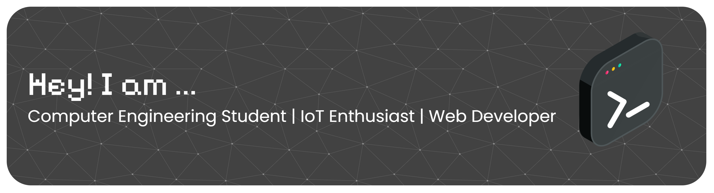

<!--
  GitHub Profile README
  Replace YOUR_USERNAME with your GitHub username.
-->

  

# Hi, I'm Muhammad Ikhsan Al Fajri 👋

### Computer Engineering Student | IoT Enthusiast | Aspiring Developer

Building practical solutions through technology, automation, and code.

  

  
  
  
  
  

---

## 👨‍💻 About Me

Hello! I'm a Diploma (D3) Computer Engineering student at Universitas Sriwijaya, Indonesia.

I'm interested in developing technology-based solutions, especially in the fields of the Internet of Things (IoT), embedded systems, and web development.

I enjoy experimenting with hardware, writing code, and building projects that connect physical devices with software applications.

- 🎓 Computer Engineering student at Universitas Sriwijaya.
- ⚡ Exploring IoT development with ESP32.
- 🔧 Learning about embedded systems and hardware integration.
- 🌐 Developing web applications and monitoring dashboards.
- 🚀 Continuously learning, building, and improving.

## 🛠️ Tech Stack

### Programming Languages & Web

  

### IoT & Embedded Systems

  
  
  
  

### Database & Development Tools

  

> My technology stack reflects the tools I use and explore in my projects. I'm continuously expanding my skills.

---

## 🚀 Featured Project

### 🗑️ Smart Trash Bin — IoT-Based Automatic Trash Bin

An IoT-based smart trash bin project designed to automate lid control and support waste management through embedded hardware and web technologies.

**Key Features**

- Automatic lid control using an ESP32 and servo motor.
- Infrared sensor for object or hand detection.
- Web dashboard concept for device monitoring.
- Integration between embedded hardware and web applications.

**Technologies**

- ESP32
- Arduino IDE
- Infrared Sensor
- Servo Motor
- JavaScript / Node.js
- Web Dashboard

**Project Goal**

To develop a practical smart waste management solution by combining embedded systems, automation, and web-based monitoring.

> Project status: In Development.

---

## 📊 GitHub Statistics

 

---

## 🎯 Current Goals

- Strengthen my knowledge of IoT and embedded systems.
- Build more ESP32-based projects.
- Improve my web development skills.
- Connect hardware devices with web-based applications.
- Create practical projects for my developer portfolio.

---

## Social Media

  
  
  
  

### "Learn continuously. Build thoughtfully. Improve every day." ✨

